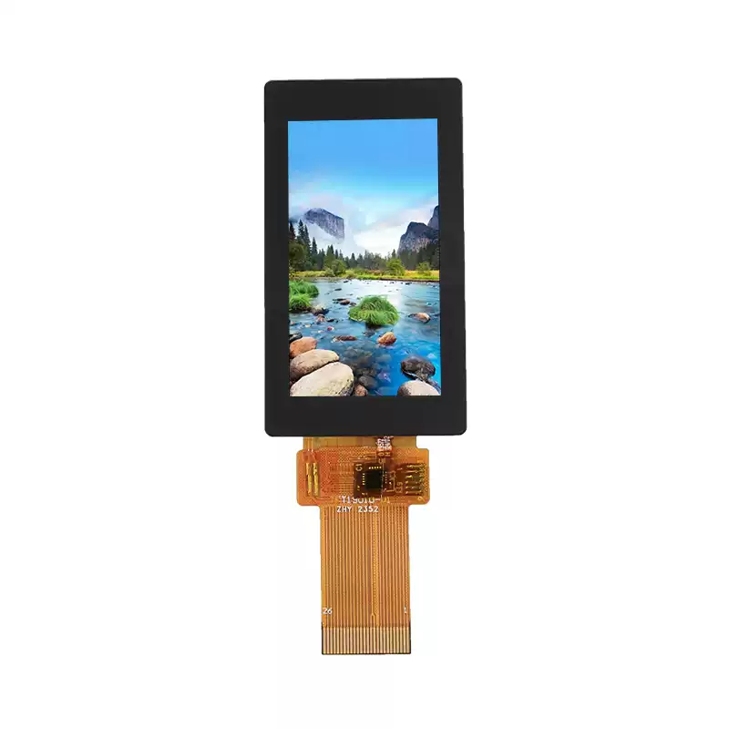

<p align="left"></p>

<h1 align="center">OSPTEK 1.9″ TFT Display 170×320 (YDP190HT002-V9)</h1>

<p align="center"><b>TFT module · MCU/QSPI · ST7789</b></p>

<p align="center"><a href="./README.md">简体中文</a> | English · <a href="../../README_EN.md">Family index</a></p>

<p align="center">
  
  
  
</p>

<p align="center"></p>

## Contents

- [Specifications](#specifications)
- [Resources](#resources)
- [Repository layout](#repository-layout)
- [Buy](#buy)
- [Support](#support)

---

## Specifications

| Item | Spec |
| ---- | ---- |
| Size | 1.9 inch |
| Type | TFT |
| Resolution | 170×320 |
| Outline | 30.00 x 65.00 x 3.51 mm |
| Active area | 22.7 x 42.72 mm |
| Interface | MCU/QSPI |
| Driver IC | ST7789 |
| Touch IC | CST816D |

> Full outline, FPC definition, power, and timing follow the product datasheet / driver IC datasheet.

## Resources

| Category | File |
| ---- | ---- |
| Datasheet | [`ST7789V3_SPEC_Preliminary_V0.0_200102.pdf`](./datasheets/ST7789V3_SPEC_Preliminary_V0.0_200102.pdf) |
| Datasheet | [`YDP190HT002-V9.pdf`](./datasheets/YDP190HT002-V9.pdf) |
| CAD file | [`YDP190HT002-V9_外形图.pdf`](./cad/YDP190HT002-V9_%E5%A4%96%E5%BD%A2%E5%9B%BE.pdf) |
| Init code | [`ST7789_HSD1.9-2.2gamma-20230411.txt`](./code/ST7789_HSD1.9-2.2gamma-20230411.txt) |

## Repository layout

```text
display-tft-1.9inch-170x320/ # repo root (nav: ../../README_EN.md; sample projects under root examples/)
└── versions/
    └── YDP190HT002-V9/        # full materials for this part number
        ├── README.md
        ├── README_EN.md
        ├── osptek.yml
        ├── images/
        ├── datasheets/       # product datasheet + driver/touch IC datasheets
        ├── cad/              # outline/cover CAD
        └── code/             # init reference code
```

## Buy

See the [repo home page](../../README_EN.md#where-to-buy).

## Support

See the [repo home page](../../README_EN.md#support).

---

<p align="center"><sub>© 2026 OSPTEK · Materials in this repository are licensed under CC BY 4.0</sub></p>
